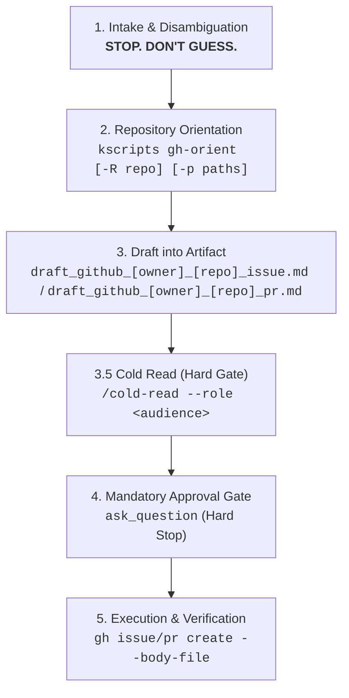

# GitHub Post (`/gh-post`)

Guidelines, automated orientation tooling, and execution protocols for authoring
and submitting high-signal, anti-slop GitHub issues and pull requests without AI
formatting noise.

## Quick Start

```bash
# Orient with a local Git repository checkout's conventions:
kscripts gh-orient --dir /path/to/repo [-p lib/src/foo.dart]

# Orient with a remote GitHub repository (zero local clone required):
kscripts gh-orient -R invertase/melos [-p packages/melos/lib/melos.dart]
```

Trigger via `/gh-post <request>` (e.g., `/gh-post a PR with these changes` or
`/gh-post a bug report for the crash on empty config`).

## The 5-Step Workflow



### Step 1: Intake & Disambiguation (STOP. DON'T GUESS.)

Confirm two parameters before doing any work:

1. **Target Post Type**: **Issue** (Bug Report / Feature Proposal) or **Pull
   Request**?
2. **Target Repository**: Exact GitHub repository (`owner/repo`)?

> [!IMPORTANT]
>
> **STOP. DON'T GUESS.** If Issue vs. PR is ambiguous, or if `owner/repo` cannot
> be deterministically resolved from the checkout (or multiple remotes/forks
> exist), **STOP and ask the user** via `ask_question` or chat before
> proceeding.

### Step 2: Repository Orientation

Run `kscripts gh-orient` (or `gh-orient`) to inspect maintainers, title
prefixes, label vocabulary, native templates (`.yml` field IDs), and audience:

- **Audience (`-p, --paths`)**: Pass repository-relative paths referenced by the
  draft. `owner` (one author dominates or small repo) = zero background, open
  directly with what is wrong or changes. `visitor` (distributed/rotating
  triage, or default when unsure) = one orienting line + permalink, then the
  defect.
- **No Unsolicited `@mention` Guardrail**: Inline `@username` mentions on GitHub
  trigger public notifications. Use maintainer handles from `gh-orient`
  _strictly_ for internal context—**NEVER** add unsolicited `cc @username`
  mentions to issue or PR bodies unless explicitly instructed by the user.
- **Slop Contagion Guardrail**: Use orientation output _strictly_ for taxonomy,
  prefixes (`feat(scope):`, `[subsystem]`), and template adherence; keep plain
  declarative prose regardless of emojis or fluff in historical posts.

### Step 3: Draft into an ARTIFACT First

Draft the complete title and body into a Markdown artifact in
`<appDataDir>/brain/<conversation-id>/` (`RequestFeedback: false`,
`UserFacing: true`) before touching `gh`:

- **Issues**: `draft_github_<owner>_<repo>_issue.md` (Line 1:
  `# <Proposed Title>`, Line 2: blank; strip via `tail -n +3`).
- **Pull Requests**: `draft_github_<owner>_<repo>_pr.md` (Line 1:
  `# <Proposed Title>`, Line 3: `🛡️ Paranoia Tier:` banner; strip via
  `tail -n +5`).

See [`references/templates.md`](references/templates.md) for Bug Report, Feature
Proposal, and PR templates, title pattern tables, YAML Issue Form mappings,
conditional benchmark `<details>` blocks, and CLI/web-form submission snippets.

#### Core Philosophy: Five Principles + GitHub Mechanics

Write for the reader's next decision (under 15 seconds), not for the record of
your work:

<!-- BEGIN SPOT: workflow-outbound-five-principles -->

1. **Lead with the decision.** Line 1 states the defect, ask, or change.
   Discovery history and process narrative go last or in a collapsed block.
2. **Budget words by reader count.** Title: hundreds of readers, search key +
   decision signal, `<= 70` chars. First 3 lines: tens, enough to triage or
   review. Body: one reader, repro + evidence + permalinks.
3. **Report the delta, not the tour.** Open with what is wrong or what changes.
   The owner already knows how their code works today, so a "currently, X does
   Y" opener is cut; a visitor gets one orienting line + permalink.
4. **Fill a slot only if it changes a decision.** Delete empty template
   sections, headers over single paragraphs, and parenthetical asides. One
   audience and one owner per artifact.
5. **Anchor, verify, then cold-read.** In issues/bugs, every claim carries a
   permalink and repro/verification steps. In PRs and code reviews, never
   narrate the diff file-by-file or recite routine CI checks (`dart analyze`/
   `dart test`)—state only the intent/why, non-obvious callouts or breaking
   changes, `Fixes #N`, and non-CI verification (e.g. benchmarks or manual UI
   checks). Traces go in `<details>` or issue attachments. Run `/cold-read` on
   the publish form and fix anything the reader cannot decide from the first 3
   lines.

<!-- END SPOT: workflow-outbound-five-principles -->

GitHub-specific mechanics:

- **GitHub Permalinks & `<details>`**: Anchor claims to GitHub `https://`
  permalinks
  (`https://github.com/<owner>/<repo>/blob/<commit>/<file>#L<start>-L<end>`) or
  repo-relative backtick paths—never `file://` URLs. Wrap raw CLI output, stack
  traces, and benchmark tables in `<details><summary><b>...</b></summary>` (with
  blank lines inside; never use `<details>` to repeat PR file diffs).
- **Submission Hygiene**: Keep tight declarative prose, omit unsolicited
  `cc @username` mentions, and always submit via `--body-file -` (see
  [`references/templates.md`](references/templates.md)).

#### Explicit 3D Paranoia Header for PR Draft Previews (`OQ3`)

Display the computed **3D Paranoia Classification** at the top of
`draft_github_<owner>_<repo>_pr.md` (below `# <Proposed Title>`) and in chat
(strip before `gh pr create`):

<!-- BEGIN SPOT: workflow-3d-paranoia-tiers -->

- **Banner Format**: Render at the top of review and PR draft preview artifacts
  (and in chat):
  `🛡️ Paranoia Tier: Ring <0..4B> (<Label>) · Confidence: <High|Low> · Door: <🚪 One-Way | 🔄 Two-Way>`
- **Reuse Ring (`Ring 0..4B`)**: `Ring 0` (personal dotfiles & private configs)
  · `Ring 1-2` (public skills, utilities & internal scripts) · `Ring 3`
  (published `pub.dev` packages) · `Ring 4A` (upstream Dart/Flutter framework &
  packages) · `Ring 4B` (upstream C++, Dart VM internals, WIMP, Skwasm engine).
  Default to `Review Mode: Standard` on `Ring 0-2` and `Review Mode: Deep` on
  `Ring 3-4` or when `--deep` (`--paranoid`) is passed.
- **Confidence (`High | Low`)**: `High` for familiar pure Dart, CLI, package &
  framework code; `Low` (forcing `Review Mode: Deep`) for unfamiliar C++, VM
  internals, or WIMP/Skwasm/engine plumbing.
- **Door Type (`🚪 One-Way | 🔄 Two-Way`)**: `🚪 One-Way` (forcing
  `Review Mode: Deep`) for public `api.txt` / CLI flag / JSON schema deltas,
  SemVer `-wip` bumps, DB migrations, or CI release workflows; `🔄 Two-Way` for
  internal `lib/src/` refactors, isolated tests, and docs.

<!-- END SPOT: workflow-3d-paranoia-tiers -->

### Step 3.5: Cold Read (Hard Gate for Issue and PR Bodies)

Before the approval gate, hand the **publish form** of the draft to a
fresh-context reader via `cold-read`
([kevmoo/kevmoo_skills](https://github.com/kevmoo/kevmoo_skills)) or an isolated
read-only subagent given only its persona, role (`N=3`), and publish-form text:

1. **Publish form**: issues `tail -n +3 <draft>`, PRs `tail -n +5 <draft>`, with
   `# <Proposed Title>` re-added as line 1.
2. **Role** from Step 2: issue + `owner` → `--role owner`; issue + `visitor` →
   `--role triager`; any PR → `--role reviewer`.
3. **Gate**: proceed only when `verdict` is `decide_in_n` and `cut_list` has no
   entries outside required repo PR checklists (e.g., CLA). Otherwise move the
   deciding sentence to line 1, apply `cut_list`, add `missing` facts, and
   re-run once. Skip for comments/replies `<= 50` words.

### Step 4: Two-Layer Pre-Chew Gate & Approval (Hard Stop)

1. **Layer A (Internal Pre-Flight Brief in Chat, `<= 50` lines)**: Cover (1)
   title & audience rationale, (2) code changes or root causes by file, (3)
   tests executed, and (4) Step 3.5 verdict in one line. Never leak Layer A's
   forensic trace into the outbound GitHub body.
2. **Layer B (Outbound Payload Approval)**: Halt and prompt via `ask_question`:
   - Option 1: `(Recommended) Yes, create <issue|PR> via gh <issue|pr> create`
   - Option 2: `No, keep as draft only (let me edit/pre-chew the framing)`

### Step 5: Execution & Verification

1. **Pre-PR Check (`~/github/kevmoo/*`)**: Run `kscripts pr-check` before
   `gh pr create`.
2. **Submit via `--body-file -`**: Run `tail -n +3` (Issue) or `tail -n +5` (PR)
   piped to `gh issue/pr create --body-file -` (see
   [`references/templates.md`](references/templates.md)), then output the
   resulting clickable GitHub link.
